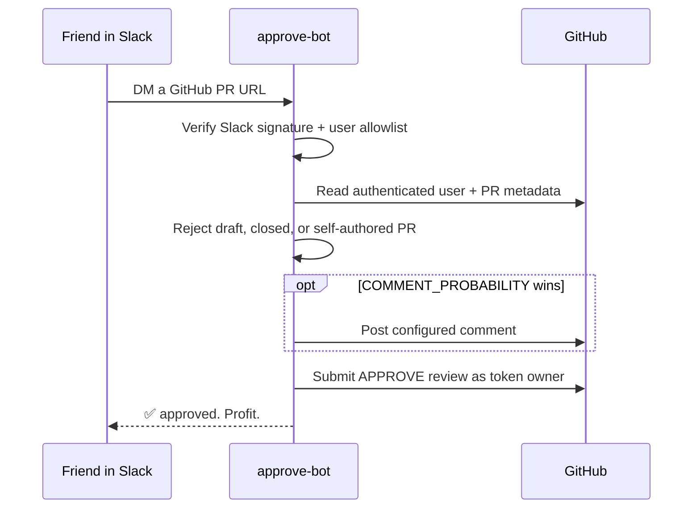

<div align="center">
  
  <h1>approve-bot</h1>
  <p><strong>Slack a pull request. Approve it from OOO-land.</strong></p>

  [](https://github.com/sam-silv/approve-bot/actions/workflows/ci.yml)
  [](https://github.com/sam-silv/approve-bot/actions/workflows/audit.yml)
  [](LICENSE)
  [](https://www.rust-lang.org/)
</div>

`approve-bot` is a deliberately small Slack app that approves GitHub pull requests using your GitHub user token. DM it a PR URL; it checks the sender, inspects the PR, optionally drops a tasteful bit of review theater, and submits an `APPROVE` review.

> [!WARNING]
> This app delegates the power of your GitHub credential. Use a short-lived, fine-grained token, keep the Slack allowlist narrow, and read the [security model](#security-model) before deploying it.

## What it does

- Accepts PR URLs in Slack DMs (channel messages are opt-in).
- Verifies every Slack request with HMAC-SHA256 and a five-minute timestamp window.
- Allows only configured Slack **user IDs**, not spoofable display names.
- Ignores Slack retries, bot messages, message edits, drafts, closed PRs, and self-authored PRs.
- Approves one or several PR URLs per message.
- Optionally posts a random configurable comment before approval.
- Supports dry-run mode and GitHub Enterprise Server.
- Replies in a thread with a result for each PR.

## How it works



Slack gets an immediate `200 OK`; the GitHub work continues asynchronously. Duplicate event IDs are held for ten minutes so Slack retries cannot create repeated reviews.

## Quick start

### 1. Create the Slack app

1. Open [Slack API apps](https://api.slack.com/apps) and choose **Create New App → From an app manifest**.
2. Paste [`slack-manifest.yml`](slack-manifest.yml).
3. Replace the placeholder request URL with `https://YOUR_HOST/slack/events`.
4. Install the app to your workspace.
5. Copy the **Signing Secret** and **Bot User OAuth Token**.

The manifest requests only `chat:write`, `im:history`, and `app_mentions:read`. If you only use DMs, you can remove the `app_mention` subscription and `app_mentions:read` scope.

### 2. Create a GitHub token

Create a fine-grained personal access token for only the repositories the bot may approve. Grant:

- **Metadata:** read
- **Pull requests:** read and write
- **Issues:** read and write, only if optional PR comments are enabled

The approval is attributed to the token owner. GitHub will reject approvals of that same user's own PRs; the bot also detects and reports this before trying.

### 3. Configure and run

```bash
cp .env.example .env
# Fill in the secrets and your friend's Slack member ID.
docker compose up --build
```

Expose port `3000` through a public HTTPS endpoint and set Slack's event request URL to `/slack/events`. For a local smoke test, an HTTPS tunnel such as Cloudflare Tunnel or ngrok works well.

To run without Docker:

```bash
cargo run --release
```

Health check: `GET /healthz`.

## Configuration

| Variable | Required | Default | Meaning |
|---|---:|---|---|
| `SLACK_SIGNING_SECRET` | yes | — | Slack app signing secret |
| `SLACK_BOT_TOKEN` | yes | — | Bot token beginning with `xoxb-` |
| `GITHUB_TOKEN` | yes | — | Fine-grained PAT or user access token |
| `ALLOWED_SLACK_USER_IDS` | yes* | — | Comma-separated Slack member IDs, e.g. `U0123,U0456` |
| `ALLOW_ALL_USERS` | no | `false` | Disable the sender allowlist; strongly discouraged |
| `ALLOW_CHANNEL_MESSAGES` | no | `false` | Accept app mentions and non-DM messages |
| `APPROVAL_COMMENTS` | no | — | `|`-separated optional comments |
| `COMMENT_PROBABILITY` | no | `0` | Chance from `0` to `1` of posting one comment per PR |
| `APPROVAL_REVIEW_BODY` | no | — | Body attached to the approving review |
| `DRY_RUN` | no | `false` | Validate and report without writing to GitHub |
| `LISTEN_ADDR` | no | `0.0.0.0:3000` | HTTP listen address |
| `GITHUB_API_URL` | no | `https://api.github.com/` | GitHub REST API base URL |
| `GITHUB_WEB_HOST` | no | `github.com` | Exact allowed host in submitted PR URLs |
| `RUST_LOG` | no | `approve_bot=info` | `tracing` filter |

\* Not required when `ALLOW_ALL_USERS=true`.

Example nonsense, kept safely in configuration rather than hard-coded:

```dotenv
APPROVAL_COMMENTS=nice commas|the abstractions yearn for the mines|ran it locally (spiritually)
COMMENT_PROBABILITY=0.35
APPROVAL_REVIEW_BODY=LGTM from OOO-land 🌴
```

## Security model

This is intentionally **not** an AI reviewer. Possession of an allowed Slack identity plus a valid PR URL is the approval policy. That is convenient and risky by design.

- The raw Slack request body is authenticated before JSON parsing.
- User authorization happens before any GitHub request.
- URL parsing requires HTTPS and an exact configured hostname.
- Secrets are read from the environment and redacted from `Debug` output.
- Logs identify users and PRs but never tokens or signing secrets.
- The container runs as a non-root user with a read-only filesystem in Compose.
- No database is used; replay IDs live in memory and disappear on restart.

Recommended deployment controls:

1. Use a fine-grained PAT scoped to selected repositories and set an expiration date.
2. Put only trusted Slack member IDs in `ALLOWED_SLACK_USER_IDS`.
3. Leave `ALLOW_CHANNEL_MESSAGES=false` unless channel approvals are intentional.
4. Keep branch protection rules, required checks, CODEOWNERS, and required approval counts in GitHub. This bot does not bypass them.
5. Run one replica unless you add shared replay storage upstream.

See [SECURITY.md](SECURITY.md) for vulnerability reporting and operational guidance.

## Development

```bash
cargo fmt --all -- --check
cargo clippy --all-targets --all-features -- -D warnings
cargo test --all-features
```

The suite uses in-memory fakes and local mock HTTP servers—no Slack or GitHub credentials are needed. See [CONTRIBUTING.md](CONTRIBUTING.md) for project conventions.

## License

[MIT](LICENSE) © 2026 sam-silv
